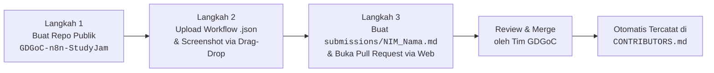

# Panduan Pengumpulan Tugas n8n Study Jam
## GDG on Campus Universitas Widyatama — 100% Web Browser (Zero Terminal)

Selamat datang di panduan pengumpulan tugas **n8n AI & Automation Study Jam** yang diselenggarakan oleh **GDG on Campus (GDGoC) Universitas Widyatama**!

Panduan ini disusun secara khusus agar **seluruh peserta dapat mengumpulkan tugas secara mudah dan mandiri 100% melalui Web Browser** (Google Chrome, Microsoft Edge, Mozilla Firefox, dsb.) tanpa perlu menginstal Git CLI, tanpa perlu membuka terminal, dan tanpa ribet.

---

## 📋 Daftar Isi
1. [Alur Singkat (Overview)](#-alur-singkat-overview)
2. [Prasyarat Sebelum Mengumpulkan](#-prasyarat-sebelum-mengumpulkan)
3. [Langkah 1: Buat Repositori Publik di Akun GitHub Pribadi](#-langkah-1-buat-repositori-publik-di-akun-github-pribadi)
4. [Langkah 2: Upload Workflow .json & Bukti Eksekusi (Drag & Drop)](#-langkah-2-upload-workflow-json--bukti-eksekusi-drag--drop)
5. [Langkah 3: Tambahkan File Pengumpulan & Buka Pull Request](#-langkah-3-tambahkan-file-pengumpulan--buka-pull-request)
6. [Contoh Format File Markdown Pengumpulan](#-contoh-format-file-markdown-pengumpulan)
7. [Keamanan Data & Sanitasi Kredensial](#-keamanan-data--sanitasi-kredensial)
8. [FAQ & Pertanyaan Sering Diajukan](#-faq--pertanyaan-sering-diajukan)

---

## ⚡ Alur Singkat (Overview)



---

## 🛠️ Prasyarat Sebelum Mengumpulkan

Sebelum memulai pengumpulan, pastikan Anda telah menyiapkan:
- [x] Akun GitHub yang aktif (silakan daftar di [github.com](https://github.com) jika belum memiliki akun).
- [x] Alur kerja (workflow) n8n yang sudah berhasil dijalankan (status eksekusi sukses / node berwarna hijau).
- [x] File alur kerja yang sudah di-export dari kanvas n8n dalam format `.json`.
- [x] Tangkapan layar (*screenshot*) bukti eksekusi yang menunjukkan alur kerja berjalan dengan lancar dan output data terlihat jelas.

---

## 🚀 Langkah 1: Buat Repositori Publik di Akun GitHub Pribadi

Langkah pertama adalah membuat sebuah repositori khusus di akun GitHub pribadi Anda yang berfungsi sebagai wadah penyimpanan aset tugas dan etalase portofolio publik Anda.

1. Buka peramban (browser) dan pastikan Anda sudah masuk (*sign in*) ke [GitHub](https://github.com).
2. Akses halaman pembuatan repositori baru melalui tautan: 👉 **[github.com/new](https://github.com/new)** (atau klik ikon **`+`** di pojok kanan atas layar lalu pilih **New repository**).
3. Isi formulir konfigurasi repositori sebagai berikut:
   - **Repository name**: ketik persis `GDGoC-n8n-StudyJam`
   - **Description** *(opsional)*: contoh `Kumpulan tugas dan alur kerja otomasi n8n AI Study Jam GDGoC Universitas Widyatama`
   - **Visibility**: **PILIH PUBLIC**
     > [!IMPORTANT]
     > Repositori **WAJIB disetel ke PUBLIC**. Jika repositori disetel ke *Private*, tim reviewer dan sistem verifikasi tidak akan dapat memeriksa berkas tugas Anda sehingga proses peninjauan tidak dapat dilakukan.
   - **Initialize this repository with**: centang opsi **Add a README file**.
4. Klik tombol hijau **Create repository** di bagian bawah halaman.

Sekarang Anda telah memiliki repositori publik dengan alamat:
`https://github.com/<username-anda>/GDGoC-n8n-StudyJam`

---

## 📂 Langkah 2: Upload Workflow `.json` & Bukti Eksekusi (Drag & Drop)

Pada langkah ini, Anda akan mengunggah file alur kerja n8n dan bukti screenshot ke repositori `GDGoC-n8n-StudyJam` yang baru saja Anda buat.

### 2.1 Cara Export Workflow dari n8n
1. Buka kanvas workflow Anda di n8n (baik n8n Cloud, Desktop, maupun Self-Hosted).
2. Pastikan workflow telah berhasil dijalankan (*Test step* / *Execute workflow* sukses).
3. Klik menu titik tiga (**`...`**) di pojok kanan atas kanvas n8n atau buka menu alur kerja, lalu pilih **Export** / **Download**.
4. Beri nama file workflow sesuai format penamaan wajib:
   ```text
   P<NomorPertemuan>_<NamaLengkap>.json
   ```
   *Contoh:*
   - `P1_Dyaksa.json`
   - `P1_Budi_Santoso.json`
5. Ambil tangkapan layar (*screenshot*) kanvas n8n saat seluruh node berstatus sukses (hijau) dan data output tampak pada panel eksekusi. Beri nama file bukti dengan format serupa, misalnya `P1_Dyaksa.png`.

> [!CAUTION]
> **PERINGATAN KEAMANAN (SANITASI KREDENSIAL)**:
> Sebelum mengunggah file `.json`, buka berkas tersebut dengan aplikasi Text Editor (Notepad, VS Code, atau TextEdit). Periksa dan **HAPUS** semua kredensial sensitif seperti OpenAI API Key, Token Bot Telegram, Client Secret OAuth, password, atau webhook URL yang bersifat rahasia. Gantilah nilainya dengan placeholder umum, misalnya:
> `"apiKey": "YOUR_OPENAI_API_KEY_HERE"`

### 2.2 Struktur Folder yang Dianjurkan di Repositori Pribadi Anda
Agar rapi dan mudah dinavigasi, Anda disarankan menyusun berkas berdasarkan pertemuan (P1 sampai P5):

```text
GDGoC-n8n-StudyJam/
├── README.md
├── Pertemuan-01/
│   ├── P1_Nama.json
│   └── P1_Nama.png
├── Pertemuan-02/
│   ├── P2_Nama.json
│   └── P2_Nama.png
├── Pertemuan-03/
│   ├── P3_Nama.json
│   └── P3_Nama.png
├── Pertemuan-04/
│   ├── P4_Nama.json
│   └── P4_Nama.png
└── Pertemuan-05/
    ├── P5_Nama.json
    └── P5_Nama.png
```

### 2.3 Mengunggah Berkas via Web Browser (Drag & Drop)
1. Di halaman repositori `GDGoC-n8n-StudyJam` Anda, klik tombol **Add file** di pojok kanan atas daftar berkas, lalu pilih **Upload files**.
2. Tarik (*drag & drop*) folder pertemuan atau file `.json` dan screenshot langsung ke area unggahan abu-abu.
3. Di bagian bawah pada kotak **Commit changes**:
   - Isi pesan komit, misalnya: `feat: upload tugas n8n pertemuan 1`
   - Pilih opsi **Commit directly to the `main` branch**.
4. Klik tombol hijau **Commit changes**.
5. Ulangi proses ini setiap kali Anda menyelesaikan tugas pertemuan berikutnya.

---

## ✍️ Langkah 3: Tambahkan File Pengumpulan & Buka Pull Request

Sekarang saatnya mendaftarkan tugas Anda ke direktori pusat pengumpulan di repositori utama **Submission-n8n-AI**. Seluruh langkah ini dilakukan **100% di browser**.

### 3.1 Buka Repositori Pusat
Buka tautan repositori pengumpulan resmi GDGoC Widyatama:
👉 **[https://github.com/xdyaksa/Submission-n8n-AI](https://github.com/xdyaksa/Submission-n8n-AI)**

### 3.2 Buat Berkas Markdown Pengumpulan Baru
1. Masuk ke folder **`submissions/`** dengan mengklik nama folder tersebut.
2. Di pojok kanan atas daftar berkas, klik tombol **Add file** lalu pilih **Create new file**.
3. Pada kotak isian nama berkas (*Name your file...*), ketikkan nama dengan format:
   ```text
   submissions/NIM_NamaLengkap.md
   ```
   *Contoh penamaan:*
   - `submissions/10121001_Dyaksa.md`
   - `submissions/202410101_Budi_Santoso.md`
   - `submissions/202410202_Siti_Aisyah.md`

   > [!NOTE]
   > Gunakan karakter garis bawah (`_`) untuk memisahkan antara NIM dan Nama Lengkap tanpa spasi khusus.

4. Pada area editor teks di bawahnya, salin (*copy*) template markdown yang ada pada bagian [Contoh Format File Markdown Pengumpulan](#-contoh-format-file-markdown-pengumpulan) di bawah ini, lalu sesuaikan data diri, link repositori, dan tautan berkas tugas Anda.

### 3.3 Commit dan Buka Pull Request
1. Gulir (*scroll*) ke bagian paling bawah halaman editor ke bagian **Commit changes**:
   - Pada kolom isian commit summary, ketik:
     `feat: submission n8n Study Jam - <NIM> - <Nama Lengkap>`
   - Pilih opsi bulatan kedua:
     🔘 **Create a new branch for this commit and start a pull request.**
   - Biarkan nama branch yang dibuat secara otomatis (misal: `patch-1` atau `submissions-nim-nama`).
2. Klik tombol hijau **Propose changes** (atau **Commit changes**).
3. Anda akan langsung dialihkan ke halaman **Open a pull request**:
   - **Title (Judul PR)**: Pastikan judul PR mengikuti format berikut:
     ```text
     Submission n8n Study Jam - <NIM> - <Nama Lengkap>
     ```
     *Contoh:*
     ```text
     Submission n8n Study Jam - 10121001 - Dyaksa
     ```
   - **Description (Deskripsi PR)**: Kotak deskripsi sudah otomatis terisi formulir template Pull Request. Lengkapi data diri Anda, beri tanda centang `[x]` pada pertemuan yang telah Anda selesaikan, dan centang seluruh poin pada checklist verifikasi mandiri.
4. Klik tombol hijau **Create pull request**.
5. Selesai! 🎉 Pull Request Anda telah resmi terkirim dan akan segera ditinjau oleh instruktur dan tim reviewer GDGoC Widyatama.

---

## 📝 Contoh Format File Markdown Pengumpulan

Salin kode Markdown di bawah ini ke dalam file `submissions/NIM_NamaLengkap.md` Anda dan sesuaikan data yang berada di dalam tanda kurung siku `[...]`:

```markdown
# Submission n8n Study Jam - GDGoC Universitas Widyatama

## 👤 Informasi Peserta
- **Nama Lengkap**: [Nama Lengkap Anda]
- **NIM**: [NIM Anda]
- **Program Studi**: [Program Studi Anda]
- **Username GitHub**: [@username-anda](https://github.com/username-anda)
- **URL Repositori Tugas**: [https://github.com/username-anda/GDGoC-n8n-StudyJam](https://github.com/username-anda/GDGoC-n8n-StudyJam)

---

## 📊 Matriks Progres Tugas (P1 - P5)

| Pertemuan | Topik Tugas | Tautan File Workflow (.json) | Bukti Eksekusi (Screenshot) | Status |
| :---: | :--- | :---: | :---: | :---: |
| **P1** | Pengenalan n8n & Workflow Automation Dasar | [P1_Nama.json](https://github.com/username-anda/GDGoC-n8n-StudyJam/blob/main/Pertemuan-01/P1_Nama.json) | [P1_Nama.png](https://github.com/username-anda/GDGoC-n8n-StudyJam/blob/main/Pertemuan-01/P1_Nama.png) | Selesai |
| **P2** | Webhook Triggers & Data Transformation | [P2_Nama.json](https://github.com/username-anda/GDGoC-n8n-StudyJam/blob/main/Pertemuan-02/P2_Nama.json) | [P2_Nama.png](https://github.com/username-anda/GDGoC-n8n-StudyJam/blob/main/Pertemuan-02/P2_Nama.png) | Selesai |
| **P3** | Advanced API Integration & Error Handling | [P3_Nama.json](https://github.com/username-anda/GDGoC-n8n-StudyJam/blob/main/Pertemuan-03/P3_Nama.json) | [P3_Nama.png](https://github.com/username-anda/GDGoC-n8n-StudyJam/blob/main/Pertemuan-03/P3_Nama.png) | Selesai |
| **P4** | AI Agent & LLM Chain Automation di n8n | [P4_Nama.json](https://github.com/username-anda/GDGoC-n8n-StudyJam/blob/main/Pertemuan-04/P4_Nama.json) | [P4_Nama.png](https://github.com/username-anda/GDGoC-n8n-StudyJam/blob/main/Pertemuan-04/P4_Nama.png) | Selesai |
| **P5** | Capstone Final Project: Smart Autonomous AI | [P5_Nama.json](https://github.com/username-anda/GDGoC-n8n-StudyJam/blob/main/Pertemuan-05/P5_Nama.json) | [P5_Nama.png](https://github.com/username-anda/GDGoC-n8n-StudyJam/blob/main/Pertemuan-05/P5_Nama.png) | Selesai |

---

## 💡 Ringkasan & Solusi Otomasi (Workflow Highlights)
Tuliskan penjelasan singkat mengenai alur kerja yang telah kamu bangun:
- **Tujuan Workflow**: (Menjelaskan masalah apa yang diselesaikan oleh otomasi n8n ini)
- **Node Kunci yang Digunakan**: (Contoh: Webhook, HTTP Request, OpenAI Chat Model, Google Sheets, Gmail, Code Node)
- **Logika Alur Kerja**: (Ceritakan secara ringkas bagaimana data diterima, diproses, dan dikirimkan ke target output)

---

## 🌟 Refleksi & Kesan Belajar
(Ceritakan pengalaman, kendala menarik yang berhasil kamu selesaikan, atau pesan kesan selama mengikuti n8n AI & Automation Study Jam bersama GDGoC Widyatama)
```

---

## 🔒 Keamanan Data & Sanitasi Kredensial

Keamanan adalah aspek paling krusial dalam rekayasa perangkat lunak dan otomasi modern. Saat mengekspor workflow dari n8n, kredensial terkadang dapat tersimpan di dalam objek konfigurasi.

**Wajib lakukan pengecekan sebelum upload:**
1. Buka file `.json` dengan teks editor.
2. Cari kata kunci: `apiKey`, `token`, `secret`, `authorization`, `bearer`, `password`.
3. Ganti nilai asli dengan teks contoh, misalnya:
   ```json
   "parameters": {
     "apiKey": "YOUR_OPENAI_API_KEY_HERE",
     "botToken": "YOUR_TELEGRAM_BOT_TOKEN_HERE"
   }
   ```
4. Apabila reviewer menemukan adanya API Key aktif yang terekspos secara publik, Pull Request Anda akan diminta untuk direvisi dan ditutup sementara demi keamanan akun Anda.

---

## ❓ FAQ & Pertanyaan Sering Diajukan

### 1. "Apakah saya perlu menginstal Git atau VS Code di komputer saya?"
**Tidak perlu sama sekali!** Seluruh proses mulai dari membuat repositori, mengunggah workflow dan screenshot, membuat berkas markdown, hingga mengajukan Pull Request dapat dilakukan 100% menggunakan web browser favorit Anda.

### 2. "Saya baru menyelesaikan Pertemuan 1 dan 2, apakah sudah boleh membuat Pull Request?"
Boleh! Anda dapat mengajukan Pull Request progres berkala. Cukup beri tanda centang pada pertemuan yang sudah selesai di berkas `submissions/NIM_NamaLengkap.md` dan di deskripsi Pull Request.

### 3. "Bagaimana jika saya ingin memperbarui workflow atau menambah tugas pertemuan berikutnya setelah Pull Request dibuat?"
Anda **TIDAK PERLU** membuat Pull Request baru!
- Untuk file di repo pribadi: Cukup upload file baru ke repositori `GDGoC-n8n-StudyJam` Anda.
- Untuk file submission di repo ini: Buka tab **Pull requests**, pilih PR Anda, klik tab **Files changed**, klik ikon pensil (**Edit this file**) pada berkas `submissions/NIM_NamaLengkap.md`, perbarui centang/link, lalu commit. PR Anda akan otomatis terbarukan.

### 4. "Apakah saya harus mengedit file `CONTRIBUTORS.md` secara manual?"
**Jangan mengedit `CONTRIBUTORS.md` secara manual.** Sistem kami menggunakan GitHub Actions otomatis yang akan mencatat nama dan tautan submission Anda ke dalam tabel kontributor segera setelah Pull Request Anda di-merge oleh instruktur/reviewer.

### 5. "Di mana saya bisa bertanya jika mengalami kendala teknis?"
Silakan bertanya melalui grup diskusi resmi **GDGoC Widyatama** atau hubungi tim instruktur dan panitia Study Jam:
- Lead / Tech Team: **[Dyaksa](https://github.com/xdyaksa)**
- Organisasi: **[GDG on Campus Universitas Widyatama](https://github.com/gdgocwidyatama)**
